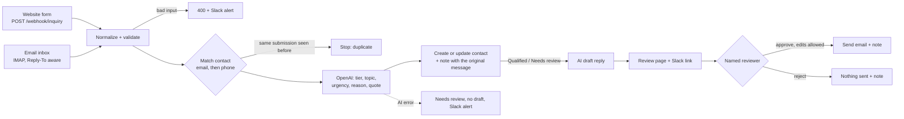

# AI Lead Intake for HubSpot (n8n + OpenAI)

An n8n setup for teams that still read every inquiry by hand and copy it into their CRM. Inquiries come in from a website form and an email inbox. Each one is matched to an existing HubSpot contact or added as a new one, and OpenAI sorts it as Qualified, Needs review or Not qualified. For leads worth answering it also drafts a reply, but a person has to approve that reply before it goes out.

The business is fictional: Tidewell Commercial Cleaning, an office cleaning company. All test inquiries are made up and use the reserved `example.com` / `example.org` domains.

## What it does

### Intake

`wfFormIntake` takes a JSON POST from a website form. `wfEmailIntake` watches the inbox over IMAP and takes the sender from `Reply-To` when there is one, since many contact forms send notification emails that way. Both turn the inquiry into the same shape: lowercased email, phone in E.164 format, message text with quoted replies removed, and a source ID (the form submission ID or the email's Message-ID). An inquiry with no email and no phone gets an HTTP 400 and a Slack alert, and nothing is written to HubSpot.

### Matching and de-duplication

The contact lookup reads HubSpot by email directly, not through the search API, because search results can lag by a few seconds and a fast follow-up would then create a second contact. If there's no email match it searches by phone. Every source ID a contact has already sent is stored on the contact, so a form that gets submitted twice or an email that is processed again stops right there: no new note, no second draft. If HubSpot answers a create with 409 (the email already exists), the workflow updates that contact instead. That path is built but no test run triggered it.

### Classification

OpenAI returns a tier, topic, urgency, a one-line reason and a short quote from the message, all in a strict JSON schema. Code checks the enum values and that the quote really appears in the message. A long quote that is still word for word is shortened rather than rejected. If the call fails or the answer doesn't pass these checks, the lead is still saved as Needs review with no draft, and Slack gets an alert. A contact that was Qualified is never downgraded by a later message. The sorting rules are plain text in [prompts/qualify.md](prompts/qualify.md).

### HubSpot record

Six custom contact properties hold the result: `lead_tier`, `inquiry_topic`, `inquiry_urgency`, `inquiry_source`, `ai_reason` and `inquiry_source_ids`. Each inquiry also adds a note to the contact with the source, time, original message and the AI's call, so a sales coordinator can check the reasoning against the message.

### Human approval

For Qualified and Needs review leads, the AI drafts a short reply. The draft goes on a review page with the original message, the AI's reasoning and a link to the HubSpot contact, and Slack gets the link. The reviewer can edit the subject and body, then approve or reject. The reviewer's name is required, and an incomplete form is sent back without anything going out. Approving sends the edited version by SMTP and adds a note like "Reply drafted by AI, edited: yes, approved by Morgan Lee (Ops) on 2026-10-29". Rejecting sends nothing and records who rejected it. If nobody responds within 72 hours, nothing is sent (this timeout path is built but wasn't exercised in the test runs).

In demo mode every approved reply goes to a test inbox instead of the made-up customer address, and the subject shows who it would have gone to.

`wfErrorHandler` catches failures in any of the workflows, masks anything that looks like a token, and posts the error to Slack.

## Tested

Eight scripted scenarios (T1 to T8), checked by `scripts/collect_results.py` against the run logs, HubSpot and the demo inbox. The counts come from code, not from the AI.

| # | Scenario | Result |
|---|---|---|
| T1 | Qualified form inquiry | New contact, Qualified, draft edited then approved |
| T2 | Same person follows up by email | Same contact, two inquiry notes, still Qualified |
| T3 | Same form submitted twice | Stopped as a duplicate, one draft only |
| T4 | Sales pitch by email | Not qualified, no draft |
| T5 | "How much do you charge?" | Needs review, draft rejected, nothing sent |
| T6 | No email and no phone | HTTP 400, Slack alert, nothing in HubSpot |
| T7 | OpenAI returns an error (a model name that doesn't exist) | Saved as Needs review, no draft, Slack alert |
| T8 | Review page | Incomplete review refused (422); T1 sent with the edits, T2 sent as drafted, T5 not sent |

Runs on a real HubSpot Free account, a Gmail test inbox and Slack, with n8n running locally:

- Mock AI (recorded answers): 8/8. Sending the same batch a second time created no new contacts or drafts.
- Live OpenAI (`gpt-4.1-mini`), first run: 4/8. The AI classified T1 correctly, but its quote was longer than the check allowed, so T1 was set aside for a human and the later steps failed with it. The check now shortens long quotes that are still word for word.
- Live OpenAI, second run: 8/8.

Details, including what went wrong along the way, are in [docs/VERIFICATION.md](docs/VERIFICATION.md) (in Traditional Chinese).

## Known limitations

- Reply drafts don't see earlier inquiries from the same contact. In the live run, the draft for T2 asked Dana for her office size and cleaning frequency, which she had already given in her first form. Right now the reviewer has to catch this. Passing the contact's earlier inquiry notes into the draft prompt would fix it.
- `ai_reason` describes the latest message, while `lead_tier` keeps the highest tier. After T2, Dana is Qualified, but the reason field explains why the follow-up on its own looked like Needs review. Each field does what it was built to do, and read side by side they seem to disagree.
- Phone matching only works for numbers stored in E.164 format, which is how this workflow writes them. Numbers typed into HubSpot by hand in another format won't match. None of the test scenarios matched a contact by phone, so this lookup is untested end to end.
- The review page is served by n8n on localhost. A team setup would need n8n on a reachable host with access control in front of it.
- Tested with HubSpot only. Pipedrive or Salesforce would need different API calls for the same steps.

## Not included

WhatsApp or social media intake, an auto-reply chatbot, follow-up sequences, deals or pipeline stages, lead scoring numbers, HubSpot paid features, and production hosting.

## Running this for your own team

This repo runs a demo for a made-up company on localhost. Putting it to work for a real team takes more:

- Hosting n8n somewhere reachable, with sign-in in front of the review page
- Setting up your HubSpot properties, keys and alert channel
- Rewriting the sorting rules and the reply tone for your business
- Connecting your own form and inbox, or a different CRM or channel such as WhatsApp
- Testing with your real kinds of inquiries before anything goes live
- Keeping it working when HubSpot, OpenAI or Gmail change something

This is the part I do for clients.

## Tech stack

- n8n 2.44.7 in Docker, bound to localhost (port 5679)
- HubSpot CRM API v3/v4 with a service key (contacts read/write, contact schema read/write)
- OpenAI Chat Completions with strict JSON schema output, plus a mock mode that runs the same workflows on recorded answers
- Gmail over IMAP and SMTP with an app password
- Slack incoming webhook
- Python standard library and Node.js built-ins only, no third-party packages

## Quick start

See [docs/SETUP.md](docs/SETUP.md) to run it, and [docs/OPERATIONS.md](docs/OPERATIONS.md) to change the rules, add a source or handle alerts.

This is a self-initiated portfolio project. The company, people and inquiries are fictional.

## License

Shared as a portfolio sample for review. It is not licensed for reuse.
